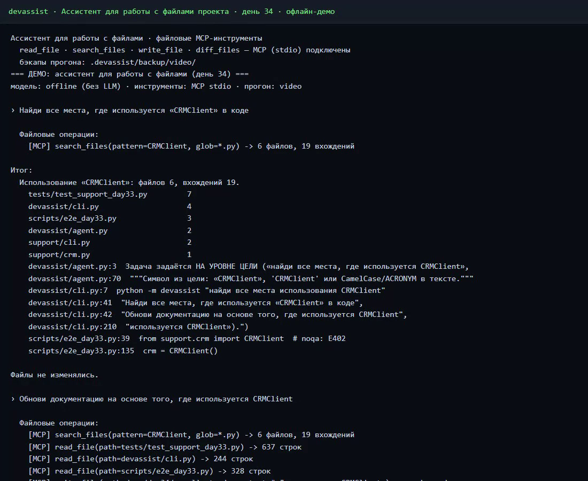
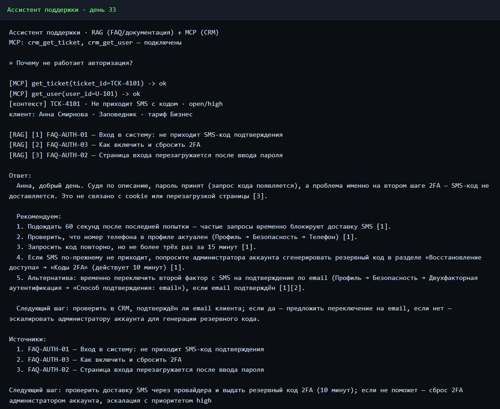

# AI Advent Challenge

[](https://github.com/imarkelov/ai_advent_challenge)


**30 дней челленджа по ИИ** — от первого запроса к LLM до агентов с
MCP-инструментами, RAG, памятью и файловыми операциями.

Каждый день — отдельная ветка с рабочим кодом, тестами и e2e-проверкой.

## Недавнее

| День | Что | Скриншот |
| --- | --- | --- |
| **35** → [qa-lead-orchestrator](https://github.com/imarkelov/ai_advent_challenge/tree/day35-qa-lead-orchestrator) | Автономный QA-пайплайн `studio2`: MD-декларации агентов, RAG по `doc/`, git-изучение, SDD на субагента, каркас теста на апрув, Kotlin-тест, прогон на эмуляторе, ревью отдельной LLM | демо будет добавлено после записи |
| **34** · [Файловый ассистент](https://github.com/imarkelov/ai_advent_challenge/tree/day34-files-assistant) | CLI по цели: 4 файловых MCP-тула (`read_file`, `search_files`, `write_file`, `diff_files`), LLM tool-loop + офлайн-план, песочница, бэкапы и diff прогона |  |
| **33** · [Ассистент поддержки](https://github.com/imarkelov/ai_advent_challenge/tree/day33-support-assistant) | RAG по FAQ/документации + контекст тикета и пользователя через MCP, ответ с источниками `[n]` |  |

```bash
# день 34: ассистент работает с файлами проекта
python -m devassist --offline --demo       # офлайн-ядро (без сети/LLM)
python -m devassist "найди все места, где используется CRMClient"
python scripts/e2e_day34.py                # 28/28: офлайн + live

# день 33: ассистент поддержки
python -m support --ticket TCK-4101
```

```text
цель («найди, обнови…»)
        │
        ▼
  ┌───────────────┐   tools / tool_calls   ┌──────────────────┐
  │  LLM (tool-   │ ─────────────────────▶ │  MCP-серверы     │
  │  loop)        │ ◀───────────────────── │  1 сервер = 1 тул│
  └───────────────┘  результат (файл:строка)└────────┬─────────┘
                                                     │
                                     файлы проекта ──┴── diff / бэкап
```

## Все дни

| День | Ветка | Задание |
| ---- | ----- | ------- |
| День 1 | [`day1`](https://github.com/imarkelov/ai_advent_challenge/tree/day1) | **API + чат** — LLM через API, интерфейс CLI и Web |
| День 2 | [`day2`](https://github.com/imarkelov/ai_advent_challenge/tree/day2) | **Контроль ответа** — формат, лимит длины, stop-последовательности |
| День 3 | [`day3`](https://github.com/imarkelov/ai_advent_challenge/tree/day3) | **Стратегии рассуждений** — прямой, пошагово, мета-промпт, группа экспертов |
| День 4 | [`day4`](https://github.com/imarkelov/ai_advent_challenge/tree/day4) | **Температура** — T=0 / 0.7 / 1.2 и LLM-сравнение ответов |
| День 5 | [`day5`](https://github.com/imarkelov/ai_advent_challenge/tree/day5) | **Версии моделей** — слабая/средняя/сильная: TTFT, TPS, токены, слепое сравнение |
| День 6 | [`day6`](https://github.com/imarkelov/ai_advent_challenge/tree/day6) | **Простой агент** — SimpleAgent: system prompt, история, API |
| День 7 | [`day7`](https://github.com/imarkelov/ai_advent_challenge/tree/day7) | **Контекст на диске** — history.json, TRON-HUD, архив диалогов |
| День 8 | [`day8`](https://github.com/imarkelov/ai_advent_challenge/tree/day8) | **Токены** — live-подсчёт, лимит контекста, JSON запроса |
| День 9 | [`day9`](https://github.com/imarkelov/ai_advent_challenge/tree/day9) | **Управление контекстом** — скользящее окно + LLM-сводка + бенчмарк |
| День 11 (студия) | [`day11-studio`](https://github.com/imarkelov/ai_advent_challenge/tree/day11-studio) | **Студия** — FastAPI + React, SSE-стриминг, 3 слоя памяти |
| День 12 | [`day12-user-profile`](https://github.com/imarkelov/ai_advent_challenge/tree/day12-user-profile) | **Персонализация** — профиль пользователя на диалог, интервью, табу |
| День 13b | [`day13-task-state-machine`](https://github.com/imarkelov/ai_advent_challenge/tree/day13-task-state-machine) | **Задача как FSM** — planning → execution → validation, карточка в чате |
| День 14 | [`day14-invariants`](https://github.com/imarkelov/ai_advent_challenge/tree/day14-invariants) | **Инварианты** — жёсткие ограничения проекта + server-side гард |
| День 15 | [`day15-plan-review`](https://github.com/imarkelov/ai_advent_challenge/tree/day15-plan-review) | **Проверка плана** — человеческий гейт между planning и execution |
| День 16 | [`day16-mcp-connect`](https://github.com/imarkelov/ai_advent_challenge/tree/day16-mcp-connect) | **Подключение MCP** — реестр серверов, JSON-RPC клиент, панель MCP |
| День 17 | [`day17-mcp-tool-loop`](https://github.com/imarkelov/ai_advent_challenge/tree/day17-mcp-tool-loop) | **MCP tool-loop** — LLM сама вызывает инструменты в цикле |
| День 18 | [`day18-mcp-digest`](https://github.com/imarkelov/ai_advent_challenge/tree/day18-mcp-digest) | **Дайджест 24/7** — свой MCP-сервер, cron, JSON-хранилище |
| День 19 | [`day19-mcp-pipeline`](https://github.com/imarkelov/ai_advent_challenge/tree/day19-mcp-pipeline) | **Композиция MCP** — search → summarize → saveToFile, PDF-движок |
| День 20 | [`day20-mcp-orchestration`](https://github.com/imarkelov/ai_advent_challenge/tree/day20-mcp-orchestration) | **Оркестрация MCP** — 10 едицельных серверов, каталог в промпте |
| День 33 | [`day33-support-assistant`](https://github.com/imarkelov/ai_advent_challenge/tree/day33-support-assistant) | **Ассистент поддержки** — RAG по FAQ + CRM через MCP, CLI |
| День 34 | [`day34-files-assistant`](https://github.com/imarkelov/ai_advent_challenge/tree/day34-files-assistant) | **Файловый ассистент** — MCP-тулы над файлами, tool-loop, diff, песочница |

## Как это устроено

- **LLM** — OpenAI-совместимый `/chat/completions` (GPUSTACK, Ollama); ключ
  всегда из `.env`, в репозиторий не попадает.
- **MCP** — свои stdio JSON-RPC серверы (1 сервер = 1 инструмент) и
  LLM-driven tool-loop: модель сама решает, какой инструмент вызвать.
- **Данные** — JSON на диске с атомарной записью, без БД и внешних сервисов.
- **Проверки** — pytest + e2e-скрипты с реальным API (offline-ядро всегда
  проходит, live — best-effort).

Новые дни — в отдельных ветках, старые остаются как есть: репозиторий можно
читать как хронологию.
